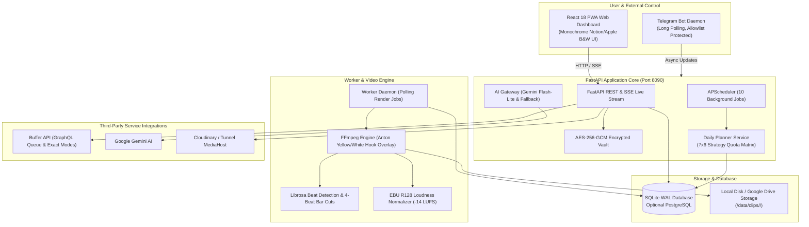

# Affiliate Autopilot

**Affiliate Autopilot** is a self-hosted, dockerized, all-in-one automation platform for TikTok creators and affiliates. It replaces fragmented legacy automation workflows (n8n, Google Sheets, external video renderers) with a unified, high-performance web dashboard (React PWA) and an asynchronous long-polling Telegram bot.

---

## Architecture Overview



---

## Key Features

- **AI Creative Pipeline:** Ported video render engine with 7 glitch defenses, Anton font `#EFD34C` hook overlay, beat-synchronized cuts (`librosa`), and Taglish caption generation with banned claims filtering.
- **5 Built-in Video Styles:**
  1. `classic_hook`: Anton yellow/white header, blurred backdrop, smooth Ken Burns zoom.
  2. `smooth_flow`: Cinematic crossfades and subtle panning for lifestyle products.
  3. `punchy_zoom`: Fast cuts, snap zooms, dynamic accent color bursts for tech accessories.
  4. `promo_pop`: High-energy promotional overlays, CTA pulses, animated badges.
  5. `clean_showcase`: Minimalist framing, elegant typography, slow pan for premium items.
- **Style Studio & Music Library:** Duplicate and customize styles with a live 9:16 canvas preview; upload or download audio with automatic beat detection and -14 LUFS loudness normalization.
- **The Daily Brain (Planner):** Autonomous 7x6 strategy quota planner adhering to 6 daily slots (09:00, 11:00, 14:00, 16:00, 19:00, 21:00), strict 1 post/product/day limit, clip readiness checks (`clip_count >= 4`), and user slot lock protection.
- **Buffer Publisher:** Direct posting via Buffer API supporting both **Queue mode** (default) and **Exact-time mode** (`customScheduled`), with automatic media hosting and quota guard.
- **Data Upload & Review Queue:** Deterministic spreadsheet parser (0 AI calls) and batched 4-6 image vision OCR for order screenshots with SHA-256 deduplication.
- **Telegram Companion Bot:** Long-polling daemon (no public ports needed) with strict allowlist authorization, media intake, daily slot summaries, and inline button approvals.
- **Synthetic Demo Mode:** Instant one-click exploration (`DEMO_MODE=true`) pre-populated with realistic products, clips, orders, and daily plans without requiring third-party credentials.

---

## Quickstart

### Prerequisites
- Docker Engine 24+ and Docker Compose v2+
- (Optional for CLI tools) Python 3.12+

### 1. Clone & Configure Environment
```bash
git clone https://github.com/your-username/affiliate-autopilot.git
cd affiliate-autopilot
cp .env.example .env
```
Edit `.env` to configure your LAN host settings and port allocations.

### 2. Launch the Application Stack
```bash
docker compose up -d
```
Verify all services are healthy:
```bash
docker compose ps
```
The web dashboard is now accessible on your local network at `http://<server-ip>:8090`.

### 3. First-Run Setup & Credentials
- Access `http://<server-ip>:8090/settings` in your browser.
- Set up your admin account (or seed from `.env.seed` using `python scripts/import_from_n8n.py`).
- Enter your Buffer API token, Gemini API key, and Telegram bot token into the encrypted vault and click **Test connection**.

### 4. Explore with Synthetic Demo Mode
To test all features without connecting real accounts:
```bash
# In .env: set DEMO_MODE=true
# Or trigger via CLI:
docker compose exec api python scripts/seed_demo.py
```
Log in to the web dashboard with username `demo_admin` and password `demo1234`.

---

## Telegram Bot Commands

| Command | Description |
|---|---|
| `/today` | Displays the 6 daily slots with product names, hook styles, and posting times. |
| `/status` | Shows system health, quota meters (Gemini, Buffer), and last run timestamps. |
| `/sales` | Displays cashflow pulse: total GMV, estimated commissions, and settled payout. |
| `/plan` | Shows today's plan with interactive inline buttons (`[Approve Plan]`, `[Regenerate]`). |
| `/pause` | Pauses automated publishing (enables dry-run safety lock). |
| `/resume` | Resumes automated publishing pipeline. |
| `/unmatched` | Lists raw product titles in the review queue for one-tap linking. |
| `/music <link>` | Triggers background yt-dlp audio download, beat detection, and normalization. |
| `<Photos / CSVs>` | Drop photos or spreadsheets directly into chat to trigger ingestion. |
| `<Free text>` | Ask questions like *"Which product made the most commission this week?"* for live AI answers. |

---

## Automated Background Schedules

All 10 background jobs run on `Asia/Manila` timezone and are fully editable via the Web UI (`/schedules`):

1. **Nightly Reminder & Orders Sync (23:59):** Ingests orders and sends night summary to Telegram.
2. **Ingest Polling (Continuous / 5m):** Processes newly uploaded files and Telegram media.
3. **Daily Planner (00:30):** Computes 7x6 strategy quota and generates tomorrow's 6 slots.
4. **Video Render Pipeline (01:00):** Renders 6 video slots using worker FFmpeg engine.
5. **Buffer Poster Sync (02:00):** Publishes rendered videos to Buffer with Taglish captions.
6. **Metrics Sync (09:00):** Updates video views, likes, comments, and shares.
7. **Drive Sync (Every 5 min):** Synchronizes raw clips from Google Drive to local cache.
8. **Weekly Report (Sunday 08:00):** Recomputes scorecard leaderboard and sends weekly summary.
9. **Media Cleanup (Daily 04:00):** Removes temporary uploaded videos older than 14 days.
10. **yt-dlp Update (Weekly Sunday 03:00):** Keeps media downloaders updated.

---

## Migration & Cutover from n8n

Follow our comprehensive migration documentation:
- [Google Sheets Schema Analysis](docs/migration/sheet-schema.md)
- [Legacy Inventory Accounting (148/148 nodes)](docs/migration/inventory.md)
- [Data Reconciliation Report](docs/migration/reconciliation_report.md)
- [Shadow Mode Parallel Run Report](docs/migration/shadow_mode_report.md)
- [Step-by-Step Cutover & Rollback Guide](docs/migration/cutover.md)

---

## Security & Privacy

- **Encrypted at Rest:** Secrets are encrypted using AES-256-GCM via `.vault.key`.
- **Argon2id Authentication:** Admin session credentials hashed using Argon2id with HMAC cookies and double-submit CSRF tokens.
- **Strict Allowlist:** The Telegram bot strictly ignores and silences any message from unauthorized chat IDs.
- **Audit Checklist:** Detailed in [docs/SECURITY_AUDIT.md](docs/SECURITY_AUDIT.md).

---

## License

This project is licensed under the **GNU Affero General Public License v3.0 (AGPL-3.0-or-later)**. See [LICENSE](LICENSE) for details. Third-party dependency licenses and notices are documented in [docs/THIRD_PARTY_LICENSES.md](docs/THIRD_PARTY_LICENSES.md).
